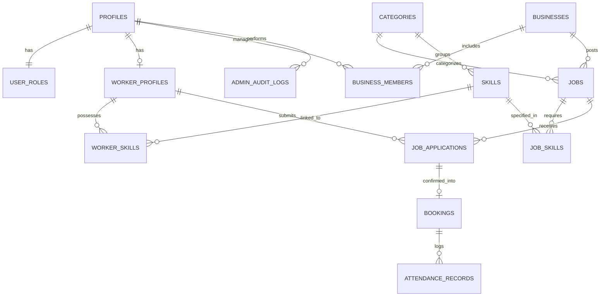

# LaganStaff — Database Schema Architecture Specification

**Document Version:** 1.0.0  
**Status:** Approved for Phase 0 Planning  
**Target Engine:** PostgreSQL 15+ (Supabase Managed Engine)  
**Notice:** *This document defines the schema architecture and relational design. No actual SQL migrations are executed during Phase 0.*

---

## 1. Entity-Relationship Overview (ERD)



---

## 2. Enumerated Types (Enums)

| Enum Type | Allowed Values | Purpose |
| :--- | :--- | :--- |
| `app_role` | `'worker'`, `'owner'`, `'admin'` | System-level authorization tier. |
| `worker_status` | `'pending_profile'`, `'active'`, `'suspended'` | Worker account standing. |
| `business_status` | `'active'`, `'suspended'` | Business standing. |
| `job_status` | `'draft'`, `'pending_admin_approval'`, `'published'`, `'filled'`, `'in_progress'`, `'completed'`, `'cancelled'`, `'rejected'` | Comprehensive job lifecycle states. |
| `application_status`| `'applied'`, `'accepted'`, `'rejected'`, `'withdrawn'` | Application resolution states. |
| `booking_status` | `'confirmed'`, `'cancelled'`, `'checked_in'`, `'completed'`, `'no_show'` | Confirmed booking shift states. |
| `attendance_status` | `'present'`, `'absent'`, `'late'`, `'left_early'` | Shift attendance recording. |
| `audit_action_type` | `'approve_first_job'`, `'reject_first_job'`, `'suspend_user'`, `'activate_user'`, `'cancel_job'`, `'update_category'` | Administrative operation types. |

---

## 3. Detailed Table Specifications

### 3.1 Table: `profiles`
- **Purpose:** Core public identity table directly linked to `auth.users`. Contains shared identity data across all user types.
- **Primary Key:** `id` (`UUID`, references `auth.users(id) ON DELETE CASCADE`)
- **Foreign Keys:**
  - `id` $\rightarrow$ `auth.users(id)`
- **Columns & Data Types:**
  - `id`: `UUID` (PK)
  - `phone`: `VARCHAR(15)` NOT NULL (E.164 formatted Indian phone number, e.g. `+919876543210`)
  - `full_name`: `VARCHAR(100)` NULL (populated during onboarding)
  - `avatar_url`: `TEXT` NULL
  - `created_at`: `TIMESTAMPTZ` DEFAULT `NOW()` NOT NULL
  - `updated_at`: `TIMESTAMPTZ` DEFAULT `NOW()` NOT NULL
- **Constraints:**
  - `UNIQUE(phone)`
- **Indexes:**
  - `idx_profiles_phone` on `phone` (B-Tree)
- **Security & PII:** Phone numbers and identity are accessible by the owning user and administrators only.

---

### 3.2 Table: `user_roles`
- **Purpose:** Securely establishes the assigned role for each profile. Strictly separates permissions.
- **Primary Key:** `id` (`UUID` DEFAULT `gen_random_uuid()`)
- **Foreign Keys:**
  - `user_id` $\rightarrow$ `profiles(id) ON DELETE CASCADE`
- **Columns & Data Types:**
  - `id`: `UUID` (PK)
  - `user_id`: `UUID` NOT NULL
  - `role`: `app_role` NOT NULL
  - `created_at`: `TIMESTAMPTZ` DEFAULT `NOW()` NOT NULL
- **Constraints:**
  - `UNIQUE(user_id, role)` — ensures deterministic role assignment.
- **Indexes:**
  - `idx_user_roles_lookup` on `(user_id, role)`
- **Security:** Modifiable exclusively by database service role or through secure onboarding RPC. Users cannot grant themselves the `admin` role.

---

### 3.3 Table: `categories`
- **Purpose:** Standardized categories for industries and work types (e.g. Waiter, Halwai Helper, Cleaner, Tent Assembly).
- **Primary Key:** `id` (`UUID` DEFAULT `gen_random_uuid()`)
- **Foreign Keys:** None
- **Columns & Data Types:**
  - `id`: `UUID` (PK)
  - `name`: `VARCHAR(100)` NOT NULL (e.g., `"Waiters"`, `"Catering Helpers"`)
  - `slug`: `VARCHAR(100)` NOT NULL (e.g., `"waiters"`)
  - `description`: `TEXT` NULL
  - `is_active`: `BOOLEAN` DEFAULT `TRUE` NOT NULL
  - `created_at`: `TIMESTAMPTZ` DEFAULT `NOW()` NOT NULL
- **Constraints:**
  - `UNIQUE(slug)`
- **Indexes:**
  - `idx_categories_slug` on `slug`
- **Security:** Read-only for workers and owners; writable exclusively by Admins.

---

### 3.4 Table: `worker_profiles`
- **Purpose:** Stores specific demographic, geographical, and verification attributes for worker users.
- **Primary Key:** `id` (`UUID` DEFAULT `gen_random_uuid()`)
- **Foreign Keys:**
  - `user_id` $\rightarrow$ `profiles(id) ON DELETE CASCADE`
- **Columns & Data Types:**
  - `id`: `UUID` (PK)
  - `user_id`: `UUID` NOT NULL
  - `gender`: `VARCHAR(20)` NULL
  - `date_of_birth`: `DATE` NULL
  - `experience_years`: `SMALLINT` DEFAULT 0 NOT NULL
  - `locality`: `VARCHAR(150)` NOT NULL (e.g., `"Lanka, Ghazipur"`)
  - `city`: `VARCHAR(100)` DEFAULT `'Ghazipur'` NOT NULL
  - `latitude`: `NUMERIC(10, 7)` NULL
  - `longitude`: `NUMERIC(10, 7)` NULL
  - `selfie_storage_path`: `TEXT` NULL (relative path in `worker-selfies` private bucket)
  - `status`: `worker_status` DEFAULT `'pending_profile'` NOT NULL
  - `is_selfie_verified`: `BOOLEAN` DEFAULT `FALSE` NOT NULL
  - `created_at`: `TIMESTAMPTZ` DEFAULT `NOW()` NOT NULL
  - `updated_at`: `TIMESTAMPTZ` DEFAULT `NOW()` NOT NULL
- **Constraints:**
  - `UNIQUE(user_id)` — One-to-one relationship with `profiles`.
- **Indexes:**
  - `idx_worker_profiles_user` on `user_id`
  - `idx_worker_profiles_status` on `status`
  - `idx_worker_profiles_coords` on `(latitude, longitude)`
- **Security:** Private. Accessible only by the worker themselves and authorized administrators. Selfie path is never exposed publicly.

---

### 3.5 Table: `skills`
- **Purpose:** Standardized master list of individual micro-skills linked to categories.
- **Primary Key:** `id` (`UUID` DEFAULT `gen_random_uuid()`)
- **Foreign Keys:**
  - `category_id` $\rightarrow$ `categories(id) ON DELETE CASCADE`
- **Columns & Data Types:**
  - `id`: `UUID` (PK)
  - `category_id`: `UUID` NOT NULL
  - `name`: `VARCHAR(100)` NOT NULL (e.g., `"Table Service"`, `"Large Vessel Cleaning"`, `"Tent Rigging"`)
  - `created_at`: `TIMESTAMPTZ` DEFAULT `NOW()` NOT NULL
- **Constraints:**
  - `UNIQUE(category_id, name)`
- **Indexes:**
  - `idx_skills_category` on `category_id`

---

### 3.6 Table: `worker_skills`
- **Purpose:** Join table linking workers with their verified/declared skills.
- **Primary Key:** `id` (`UUID` DEFAULT `gen_random_uuid()`)
- **Foreign Keys:**
  - `worker_profile_id` $\rightarrow$ `worker_profiles(id) ON DELETE CASCADE`
  - `skill_id` $\rightarrow$ `skills(id) ON DELETE CASCADE`
- **Columns & Data Types:**
  - `id`: `UUID` (PK)
  - `worker_profile_id`: `UUID` NOT NULL
  - `skill_id`: `UUID` NOT NULL
  - `created_at`: `TIMESTAMPTZ` DEFAULT `NOW()` NOT NULL
- **Constraints:**
  - `UNIQUE(worker_profile_id, skill_id)`
- **Indexes:**
  - `idx_worker_skills_worker` on `worker_profile_id`
  - `idx_worker_skills_skill` on `skill_id`

---

### 3.7 Table: `businesses`
- **Purpose:** Represents a business entity (Marriage Lawn, Caterer, Tent House) in Ghazipur.
- **Primary Key:** `id` (`UUID` DEFAULT `gen_random_uuid()`)
- **Foreign Keys:**
  - `created_by` $\rightarrow$ `profiles(id) ON DELETE RESTRICT`
  - `category_id` $\rightarrow$ `categories(id) ON DELETE RESTRICT`
- **Columns & Data Types:**
  - `id`: `UUID` (PK)
  - `created_by`: `UUID` NOT NULL
  - `category_id`: `UUID` NOT NULL
  - `name`: `VARCHAR(150)` NOT NULL (e.g., `"Rajwada Marriage Lawn"`)
  - `contact_person`: `VARCHAR(100)` NOT NULL
  - `contact_phone`: `VARCHAR(15)` NOT NULL
  - `address`: `TEXT` NOT NULL
  - `locality`: `VARCHAR(150)` NOT NULL
  - `city`: `VARCHAR(100)` DEFAULT `'Ghazipur'` NOT NULL
  - `latitude`: `NUMERIC(10, 7)` NULL
  - `longitude`: `NUMERIC(10, 7)` NULL
  - `gst_or_trade_id`: `VARCHAR(50)` NULL
  - `is_first_job_approved`: `BOOLEAN` DEFAULT `FALSE` NOT NULL
  - `status`: `business_status` DEFAULT `'active'` NOT NULL
  - `created_at`: `TIMESTAMPTZ` DEFAULT `NOW()` NOT NULL
  - `updated_at`: `TIMESTAMPTZ` DEFAULT `NOW()` NOT NULL
- **Constraints:**
  - `UNIQUE(name, contact_phone)`
- **Indexes:**
  - `idx_businesses_created_by` on `created_by`
  - `idx_businesses_approval_status` on `is_first_job_approved`
- **Security & Business Logic:**
  - `is_first_job_approved` is immutable from the client. It can only be flipped to `TRUE` via an administrative action (`approve_first_job`).

---

### 3.8 Table: `business_members`
- **Purpose:** Association table granting user profiles administrative rights over a business. Allows future multi-tenant operations while preserving 1:1 structure for MVP.
- **Primary Key:** `id` (`UUID` DEFAULT `gen_random_uuid()`)
- **Foreign Keys:**
  - `business_id` $\rightarrow$ `businesses(id) ON DELETE CASCADE`
  - `user_id` $\rightarrow$ `profiles(id) ON DELETE CASCADE`
- **Columns & Data Types:**
  - `id`: `UUID` (PK)
  - `business_id`: `UUID` NOT NULL
  - `user_id`: `UUID` NOT NULL
  - `role_in_business`: `VARCHAR(50)` DEFAULT `'owner'` NOT NULL (e.g. `'owner'`, `'manager'`)
  - `created_at`: `TIMESTAMPTZ` DEFAULT `NOW()` NOT NULL
- **Constraints:**
  - `UNIQUE(business_id, user_id)`
- **Indexes:**
  - `idx_business_members_lookup` on `(user_id, business_id)`

---

### 3.9 Table: `jobs`
- **Purpose:** Work shift postings published by businesses.
- **Primary Key:** `id` (`UUID` DEFAULT `gen_random_uuid()`)
- **Foreign Keys:**
  - `business_id` $\rightarrow$ `businesses(id) ON DELETE CASCADE`
  - `category_id` $\rightarrow$ `categories(id) ON DELETE RESTRICT`
  - `created_by` $\rightarrow$ `profiles(id) ON DELETE RESTRICT`
- **Columns & Data Types:**
  - `id`: `UUID` (PK)
  - `business_id`: `UUID` NOT NULL
  - `category_id`: `UUID` NOT NULL
  - `created_by`: `UUID` NOT NULL
  - `title`: `VARCHAR(150)` NOT NULL
  - `description`: `TEXT` NULL
  - `reporting_address`: `TEXT` NOT NULL
  - `latitude`: `NUMERIC(10, 7)` NOT NULL
  - `longitude`: `NUMERIC(10, 7)` NOT NULL
  - `shift_date`: `DATE` NOT NULL
  - `start_time`: `TIME` NOT NULL
  - `end_time`: `TIME` NOT NULL
  - `workers_needed`: `INTEGER` NOT NULL CHECK (`workers_needed > 0`)
  - `workers_confirmed`: `INTEGER` DEFAULT 0 NOT NULL CHECK (`workers_confirmed >= 0 AND workers_confirmed <= workers_needed`)
  - `wage_amount`: `NUMERIC(10, 2)` NOT NULL CHECK (`wage_amount > 0`)
  - `wage_rate_unit`: `VARCHAR(20)` DEFAULT `'per_shift'` NOT NULL
  - `special_instructions`: `TEXT` NULL
  - `is_first_job`: `BOOLEAN` DEFAULT `FALSE` NOT NULL
  - `status`: `job_status` DEFAULT `'draft'` NOT NULL
  - `admin_rejection_reason`: `TEXT` NULL
  - `approved_by`: `UUID` NULL REFERENCES `profiles(id)`
  - `approved_at`: `TIMESTAMPTZ` NULL
  - `created_at`: `TIMESTAMPTZ` DEFAULT `NOW()` NOT NULL
  - `updated_at`: `TIMESTAMPTZ` DEFAULT `NOW()` NOT NULL
- **Constraints:**
  - Check constraint: `workers_confirmed <= workers_needed`
- **Indexes:**
  - `idx_jobs_business` on `business_id`
  - `idx_jobs_status_date` on `(status, shift_date)`
  - `idx_jobs_coords` on `(latitude, longitude)`
  - `idx_jobs_approval_queue` on `(status, created_at)` WHERE `status = 'pending_admin_approval'`

---

### 3.10 Table: `job_skills`
- **Purpose:** Skills required for a specific job posting.
- **Primary Key:** `id` (`UUID` DEFAULT `gen_random_uuid()`)
- **Foreign Keys:**
  - `job_id` $\rightarrow$ `jobs(id) ON DELETE CASCADE`
  - `skill_id` $\rightarrow$ `skills(id) ON DELETE CASCADE`
- **Columns & Data Types:**
  - `id`: `UUID` (PK)
  - `job_id`: `UUID` NOT NULL
  - `skill_id`: `UUID` NOT NULL
- **Constraints:**
  - `UNIQUE(job_id, skill_id)`
- **Indexes:**
  - `idx_job_skills_lookup` on `(job_id, skill_id)`

---

### 3.11 Table: `job_applications`
- **Purpose:** Records worker applications for published jobs.
- **Primary Key:** `id` (`UUID` DEFAULT `gen_random_uuid()`)
- **Foreign Keys:**
  - `job_id` $\rightarrow$ `jobs(id) ON DELETE CASCADE`
  - `worker_profile_id` $\rightarrow$ `worker_profiles(id) ON DELETE CASCADE`
- **Columns & Data Types:**
  - `id`: `UUID` (PK)
  - `job_id`: `UUID` NOT NULL
  - `worker_profile_id`: `UUID` NOT NULL
  - `status`: `application_status` DEFAULT `'applied'` NOT NULL
  - `created_at`: `TIMESTAMPTZ` DEFAULT `NOW()` NOT NULL
  - `updated_at`: `TIMESTAMPTZ` DEFAULT `NOW()` NOT NULL
- **Constraints:**
  - `UNIQUE(job_id, worker_profile_id)` — strictly prevents duplicate applications.
- **Indexes:**
  - `idx_job_apps_job` on `job_id`
  - `idx_job_apps_worker` on `worker_profile_id`
  - `idx_job_apps_status` on `(job_id, status)`

---

### 3.12 Table: `bookings`
- **Purpose:** Confirmed labor contracts linking an accepted worker application to an active job shift.
- **Primary Key:** `id` (`UUID` DEFAULT `gen_random_uuid()`)
- **Foreign Keys:**
  - `job_id` $\rightarrow$ `jobs(id) ON DELETE RESTRICT`
  - `application_id` $\rightarrow$ `job_applications(id) ON DELETE RESTRICT`
  - `worker_profile_id` $\rightarrow$ `worker_profiles(id) ON DELETE RESTRICT`
  - `business_id` $\rightarrow$ `businesses(id) ON DELETE RESTRICT`
- **Columns & Data Types:**
  - `id`: `UUID` (PK)
  - `job_id`: `UUID` NOT NULL
  - `application_id`: `UUID` NOT NULL
  - `worker_profile_id`: `UUID` NOT NULL
  - `business_id`: `UUID` NOT NULL
  - `agreed_wage`: `NUMERIC(10, 2)` NOT NULL
  - `checkin_code`: `VARCHAR(4)` NOT NULL (e.g. `'4921'`, 4-digit code on worker Duty Pass entered by owner at venue gate)
  - `status`: `booking_status` DEFAULT `'confirmed'` NOT NULL
  - `cancellation_reason`: `TEXT` NULL
  - `created_at`: `TIMESTAMPTZ` DEFAULT `NOW()` NOT NULL
  - `updated_at`: `TIMESTAMPTZ` DEFAULT `NOW()` NOT NULL
- **Constraints:**
  - `UNIQUE(application_id)` — An application can result in at most one booking.
  - `UNIQUE(job_id, worker_profile_id)` — Redundant guard ensuring 1 booking per worker per job.
- **Indexes:**
  - `idx_bookings_job` on `job_id`
  - `idx_bookings_worker` on `worker_profile_id`
  - `idx_bookings_business` on `business_id`

---

### 3.13 Table: `attendance_records`
- **Purpose:** Verifies physical reporting, check-in, and check-out of booked workers at the event site.
- **Primary Key:** `id` (`UUID` DEFAULT `gen_random_uuid()`)
- **Foreign Keys:**
  - `booking_id` $\rightarrow$ `bookings(id) ON DELETE RESTRICT`
  - `marked_by` $\rightarrow$ `profiles(id) ON DELETE RESTRICT`
- **Columns & Data Types:**
  - `id`: `UUID` (PK)
  - `booking_id`: `UUID` NOT NULL
  - `marked_by`: `UUID` NOT NULL (the business owner/manager who confirmed arrival)
  - `check_in_time`: `TIMESTAMPTZ` NULL
  - `check_out_time`: `TIMESTAMPTZ` NULL
  - `status`: `attendance_status` DEFAULT `'present'` NOT NULL
  - `notes`: `TEXT` NULL
  - `created_at`: `TIMESTAMPTZ` DEFAULT `NOW()` NOT NULL
- **Constraints:**
  - `UNIQUE(booking_id)` — Exactly one attendance record per booking shift.
- **Indexes:**
  - `idx_attendance_booking` on `booking_id`

---

### 3.14 Table: `admin_audit_logs`
- **Purpose:** Append-only ledger recording all critical administrative operations for governance and compliance.
- **Primary Key:** `id` (`UUID` DEFAULT `gen_random_uuid()`)
- **Foreign Keys:**
  - `admin_id` $\rightarrow$ `profiles(id) ON DELETE RESTRICT`
- **Columns & Data Types:**
  - `id`: `UUID` (PK)
  - `admin_id`: `UUID` NOT NULL
  - `action`: `audit_action_type` NOT NULL
  - `target_entity`: `VARCHAR(50)` NOT NULL (e.g. `'jobs'`, `'users'`, `'businesses'`)
  - `target_id`: `UUID` NOT NULL
  - `previous_state`: `JSONB` NULL
  - `new_state`: `JSONB` NULL
  - `metadata`: `JSONB` NULL (e.g., client IP, user agent, notes)
  - `created_at`: `TIMESTAMPTZ` DEFAULT `NOW()` NOT NULL
- **Constraints:** None (append-only)
- **Indexes:**
  - `idx_admin_audit_created` on `created_at DESC`
  - `idx_admin_audit_admin` on `admin_id`
  - `idx_admin_audit_target` on `(target_entity, target_id)`
- **Security:** RLS forbids `UPDATE` and `DELETE` for all roles including administrators.

---

## 4. First-Job Tracking Architecture & Concurrency Guard

### 4.1 State Determination Logic
The business verification workflow requires a guaranteed transaction-safe mechanism:
1. When an owner calls `create_job()`, a database check verifies `businesses.is_first_job_approved`:
   ```sql
   IF NOT business.is_first_job_approved THEN
     -- Check if another job is currently pending approval
     IF EXISTS (SELECT 1 FROM jobs WHERE business_id = target_bid AND status = 'pending_admin_approval') THEN
       RAISE EXCEPTION 'A prior job is currently awaiting Admin approval. Please await review.';
     END IF;
     new_job_status := 'pending_admin_approval';
     is_first_flag := TRUE;
   ELSE
     new_job_status := 'published';
     is_first_flag := FALSE;
   END IF;
   ```
2. When the Admin approves the job via `approve_first_job(target_job_id)`:
   ```sql
   BEGIN
     -- Lock the business row for update
     SELECT * FROM businesses WHERE id = (SELECT business_id FROM jobs WHERE id = target_job_id) FOR UPDATE;
     
     UPDATE businesses SET is_first_job_approved = TRUE, updated_at = NOW() WHERE id = business_id;
     UPDATE jobs SET status = 'published', approved_by = auth.uid(), approved_at = NOW() WHERE id = target_job_id;
     
     INSERT INTO admin_audit_logs (admin_id, action, target_entity, target_id, new_state)
     VALUES (auth.uid(), 'approve_first_job', 'jobs', target_job_id, jsonb_build_object('status', 'published'));
   COMMIT;
   ```
