# LaganStaff — Development Roadmap: Phase 0 $\rightarrow$ Phase 11

**Document Version:** 1.0.0  
**Status:** Approved for Phase 0 Planning  
**Execution Methodology:** Sequential Phase Milestones with Strict Exit Gates  

---

## 1. Roadmap Overview (Phase 0 $\rightarrow$ Phase 11)

```mermaid
flowchart LR
    P0["Phase 0\nArchitecture & Planning"] --> P1["Phase 1\nMobile OTP Auth"]
    P1 --> P2["Phase 2\nRoles & DB Schema"]
    P2 --> P3["Phase 3\nWorker Profile & Selfie"]
    P3 --> P4["Phase 4\nOwner Profile"]
    P4 --> P5["Phase 5\nJob Posting Engine"]
    P5 --> P6["Phase 6\nAdmin Moderation"]
    P6 --> P7["Phase 7\nJob Discovery Feed"]
    P7 --> P8["Phase 8\nApplications & Capacity"]
    P8 --> P9["Phase 9\nBookings & Attendance"]
    P9 --> P10["Phase 10\nPush & Realtime"]
    P10 --> P11["Phase 11\nRelease & Hardening"]
```

---

## 2. Phase-by-Phase Execution Plan

### **Phase 0 — Project Planning & Architecture (CURRENT)**
- **Scope:** Complete PRD, system architecture, database relational schema, user workflows, security/RLS specification, role-permission matrix, folder layout, risk assessment, and roadmap.
- **Strict Rule:** Planning only. Zero Flutter/Next.js UI or application code, zero live database migrations, zero key exposures.
- **Definition of Done:** All 9 architecture documents created and validated against business constraints.

---

### **Phase 1 — Authentication & Mobile OTP Foundation**
- **Scope:**
  - Supabase Auth integration with Indian phone numbers (`+91`).
  - Mobile OTP request and verification screens in Flutter.
  - Secure session persistence on device.
  - Auth state listener and redirect routing foundation.
- **Definition of Done:** User can enter a 10-digit mobile number, receive and enter OTP, and establish an authenticated session in Supabase.

---

### **Phase 2 — Role Architecture & Database Foundation**
- **Scope:**
  - Execute PostgreSQL schema migrations (`profiles`, `user_roles`, `categories`, `skills`).
  - Implement RLS baseline security policies.
  - Build initial role selection screen (`Worker` vs `Owner`) in Flutter.
  - Implement atomic `initialize_user_role` RPC.
- **Definition of Done:** Authenticated user can select their role, creating persistent records in `profiles` and `user_roles`, and get routed to their role onboarding.

---

### **Phase 3 — Worker Onboarding, Profile & Selfie Capture**
- **Scope:**
  - Multi-step Worker onboarding UI in Flutter.
  - Profile fields: Full name, gender, DOB, locality in Ghazipur.
  - Multi-select skills picker from database taxonomy.
  - Geolocation capture (GPS permission and coordinates).
  - Camera selfie capture with device-level compression (< 300KB).
  - Upload to private Supabase Storage bucket (`worker-selfies`).
  - **Automatic Activation:** Call `complete_worker_onboarding()` RPC to set status = `active` with zero manual admin delay.
- **Definition of Done:** Worker completes onboarding, uploads selfie, is automatically activated, and reaches the Worker Dashboard.

---

### **Phase 4 — Owner Onboarding & Business Profile**
- **Scope:**
  - Owner business registration in Flutter.
  - Business profile form: Business name, category (Marriage Hall, Catering, Tent House), contact person, phone, address, Ghazipur locality.
  - Database insertion into `businesses` and `business_members` with `is_first_job_approved = FALSE`.
- **Definition of Done:** Business owner completes profile and arrives at Owner Dashboard ready to post their first job.

---

### **Phase 5 — Job Posting Engine (Owner)**
- **Scope:**
  - Create Job UI in Flutter: Category, shift date, start/end time, workers needed (e.g., 8 Waiters), wage rate (INR per shift), venue address, special instructions.
  - Form validation: Future date check, positive worker quota, valid wage.
  - Submission logic: Stored procedure checks `is_first_job_approved`. If false $\rightarrow$ status = `pending_admin_approval`.
  - Owner Job Details screen displaying "Pending Admin Review" badge.
- **Definition of Done:** Owner can post their first job, and the job correctly enters `pending_admin_approval` status in PostgreSQL.

---

### **Phase 6 — Admin Moderation & Approval Workflow (Next.js)**
- **Scope:**
  - Scaffold Next.js Admin portal (`apps/admin`) with secure login.
  - Operations dashboard & First-Job Moderation Queue.
  - Admin inspection view: Job details, wage rate, venue legitimacy.
  - **Approval Action:** Stored procedure sets `businesses.is_first_job_approved = TRUE`, job status = `published`, logs audit trail.
  - **Rejection Action:** Requires mandatory rejection reason; job status = `rejected`.
  - **Owner Resubmit Flow:** Owner edits rejected job and resubmits to queue.
  - **Subsequent Jobs Auto-Publish:** Verified owners post jobs directly to `published` status without admin gating.
- **Definition of Done:** Admin can approve/reject first jobs; approval unlocks immediate auto-publish capability for that business.

---

### **Phase 7 — Worker Job Discovery & Search Feed**
- **Scope:**
  - Worker Job Feed UI in Flutter displaying cards with category, date, pay, locality, and open slots.
  - Filtering by category (Waiters, Cleaners, Loaders) and Ghazipur localities.
  - Job details sheet with reporting venue, shift timings, and instructions.
- **Definition of Done:** Active workers can seamlessly discover and filter published jobs in Ghazipur.

---

### **Phase 8 — Application & Atomic Capacity Engine**
- **Scope:**
  - Worker "Apply Now" button with immediate feedback.
  - Duplicate application prevention (`UNIQUE(job_id, worker_profile_id)`).
  - Owner "Applicants" view displaying candidate name, skills, and application time.
  - **Atomic Capacity Enforcement:** PostgreSQL RPC with row-level locks (`SELECT ... FOR UPDATE`) ensuring confirmed count never exceeds requested capacity even under high concurrency.
- **Definition of Done:** 100 workers can attempt to apply for a 10-person job; exactly 10 slots are confirmed with zero over-allocation.

---

### **Phase 9 — Booking Confirmation & Shift Attendance**
- **Scope:**
  - Booking confirmation view for workers with venue directions and contact details.
  - Shift status tracker (Confirmed, Checked-In, Completed, No-Show).
  - Owner attendance marking screen at event venue (Check-in / Check-out).
- **Definition of Done:** Accepted workers receive a booking record, and the business owner can verify on-site attendance.

---

### **Phase 10 — Notifications & Realtime Sync**
- **Scope:**
  - Supabase Realtime integration for instant UI updates on job status and application acceptance.
  - Push notification infrastructure setup (Firebase Cloud Messaging) for background alerts.
  - In-app notification center for workers and owners.
- **Definition of Done:** Worker receives an instant alert when accepted for a job; owner receives alerts on new applications.

---

### **Phase 11 — Production Hardening, Testing & Release Build**
- **Scope:**
  - End-to-end regression testing across Worker, Owner, and Admin flows.
  - Penetration testing & RLS policy audit.
  - Release build generation: Flutter signed Android AAB / APK for Google Play Store.
  - Next.js Admin production deployment on Vercel with custom domain.
  - Supabase production environment lock-down and automated backup verification.
- **Definition of Done:** LaganStaff is live and verified for public operation in Ghazipur, UP.
