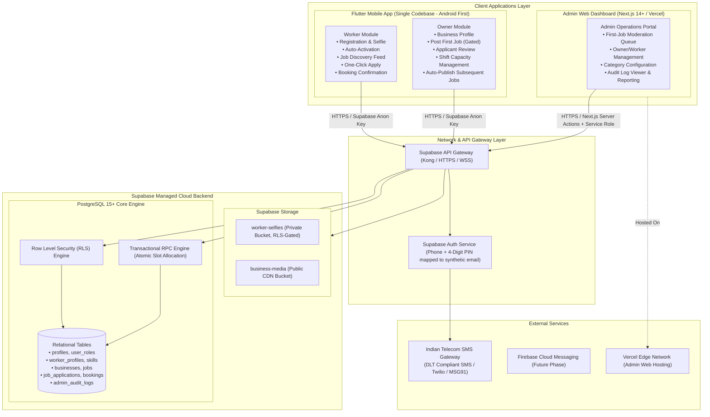
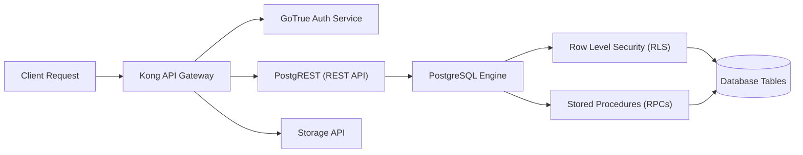

# LaganStaff — System Architecture Specification

**Document Version:** 1.0.0  
**Status:** Approved for Phase 0 Planning  
**Target Architecture:** Multi-client Single BaaS (Flutter Mobile + Next.js Web on Supabase)  

---

## 1. High-Level Architectural Diagram



---

## 2. Core System Components

### 2.1 Component Overview
The LaganStaff ecosystem is architected around a unified backend with two decoupled client interfaces:

| Component | Technology | Primary Audience | Hosting / Deployment | Primary Responsibilities |
| :--- | :--- | :--- | :--- | :--- |
| **Mobile App** | Flutter 3.x (Dart 3.x) | Workers & Business Owners | Google Play Store (Android first), iOS App Store | Dual-role mobile client handling onboarding, job posting, discovery, applications, and shift tracking. |
| **Admin Dashboard** | Next.js (App Router, TS, Tailwind) | Internal Admins | Vercel Edge Network | First-job moderation, platform dispute management, user status toggling, immutable audit logging. |
| **Backend as a Service (BaaS)** | Supabase Managed Cloud | All Clients | Managed Supabase Instance (AWS Mumbai / `ap-south-1`) | Auth, PostgreSQL database, Row Level Security, transactional RPCs, encrypted file storage. |
| **Storage Engine** | Supabase Storage (S3 API) | Workers, Businesses | AWS S3 via Supabase CDN | Private worker verification selfies, public business assets. |

---

## 3. Client Architecture

### 3.1 Flutter Mobile Client (Single Codebase, Role-Based)
The mobile application uses a **Feature-Driven Architecture** combined with `Riverpod` for reactive, compile-safe state management and `GoRouter` for declarative routing.

#### Key Architectural Decisions:
1. **Single App, Two Experiences:** Rather than maintaining two distinct mobile apps, a single binary adapts its interface based on the active session role stored in `user_roles`.
2. **Offline Resilience & Optimistic UI:** Low-bandwidth conditions in Ghazipur are mitigated through cached local data using `shared_preferences` / SQLite (Hive/Drift) for read-only listings.
3. **Strict Zero-Secrets Client:** The mobile app only bundles the public `SUPABASE_ANON_KEY`. All authorization is delegated to PostgreSQL Row Level Security (RLS) via JWT claims.

### 3.2 Next.js Admin Dashboard
The admin dashboard is an enterprise-grade web application built with the Next.js App Router and TypeScript.

#### Key Architectural Decisions:
1. **Zero Public Signup:** Registration routes do not exist. Administrators are provisioned directly by a super-admin or database seed.
2. **Server-Side Security Enforcement:** All sensitive administrative operations (e.g., job approval, user suspension) execute inside **Next.js Server Actions** or route handlers on the Vercel server.
3. **Dual Client Strategy:**
   - Client Components use the standard authenticated user session.
   - Server Actions execute administrative commands using `@supabase/ssr` with validation against the user's verified `admin` role in the database before invoking RPCs.

---

## 4. Backend & Database Architecture

### 4.1 Supabase BaaS Infrastructure
LaganStaff leverages Supabase hosted in the Indian AWS region (`ap-south-1`, Mumbai) to guarantee low network latency (< 50ms) to users in Uttar Pradesh.



### 4.2 Data Integrity & Concurrency Controls
1. **Atomic Capacity Reservation:** Job slot claiming is handled through a PostgreSQL stored procedure (`apply_for_job` and `confirm_booking`) utilizing row-level locks (`SELECT ... FOR UPDATE`). Frontend code is never trusted to calculate remaining slots.
2. **First-Job Approval State Guard:** The business verification state is governed by a dedicated trigger/function. Once an admin executes `approve_first_job(job_id)`, the associated business record is updated in an atomic transaction:
   ```sql
   UPDATE businesses SET is_first_job_approved = TRUE WHERE id = target_business_id;
   UPDATE jobs SET status = 'PUBLISHED' WHERE id = target_job_id;
   ```
3. **Audit Trail Immutability:** Any update to job status or user verification writes a record to `admin_audit_logs`. The table enforces an append-only policy with no `UPDATE` or `DELETE` grants.

---

## 5. Storage Architecture

```
supabase-storage/
├── worker-selfies/          [PRIVATE]
│   └── {worker_id}/
│       └── selfie_{timestamp}.jpg
│       • Read: Worker (own file) OR Authenticated Admin
│       • Write: Worker (own folder only)
│       • Public Access: FALSE (Requires Signed URL)
└── business-media/          [PUBLIC]
    └── {business_id}/
        └── logo.jpg
        • Read: Public (Anonymous & Authenticated)
        • Write: Business Owner (own folder)
```

---

## 6. Network & Communication Protocols

| Channel | Protocol | Security | Payload Type |
| :--- | :--- | :--- | :--- |
| **Mobile Client $\leftrightarrow$ Supabase** | HTTPS / REST (PostgREST) | TLS 1.3, Bearer JWT, RLS | JSON |
| **Admin Web $\leftrightarrow$ Supabase** | HTTPS / Server Actions | TLS 1.3, Server-side JWT | JSON |
| **Realtime Subscriptions** | WSS (WebSocket) | TLS 1.3, Channel-level auth | JSON (Change Data Capture) |
| **Media Uploads** | HTTPS / Multipart | TLS 1.3, Signed Storage Tokens | Binary / WebP / JPEG |
| **SMS OTP Verification** | HTTPS / Webhook | HMAC Signature Verification | JSON |

---

## 7. Environment & Deployment Strategy

```
┌────────────────────────────────────────────────────────────────────────┐
│                        DEVELOPMENT ENVIRONMENT                         │
│  - Flutter: Local emulator / Physical Android device (Debug Mode)      │
│  - Admin: Next.js running locally (localhost:3000)                     │
│  - Supabase: Local Supabase CLI (Docker) or Dev Hosted Project         │
└────────────────────────────────────────────────────────────────────────┘
                                    │
                                    ▼
┌────────────────────────────────────────────────────────────────────────┐
│                         STAGING ENVIRONMENT                            │
│  - Flutter: Firebase App Distribution / Internal Testing APK           │
│  - Admin: Vercel Preview Deployment (staging-admin.laganstaff.com)     │
│  - Supabase: Dedicated Staging Project (Isolated Database & Storage)   │
└────────────────────────────────────────────────────────────────────────┘
                                    │
                                    ▼
┌────────────────────────────────────────────────────────────────────────┐
│                        PRODUCTION ENVIRONMENT                          │
│  - Flutter: Google Play Console (Production Track - AAB)               │
│  - Admin: Vercel Production Deployment (admin.laganstaff.com)          │
│  - Supabase: Production Project (AWS Mumbai, High Availability, PITR)  │
└────────────────────────────────────────────────────────────────────────┘
```
