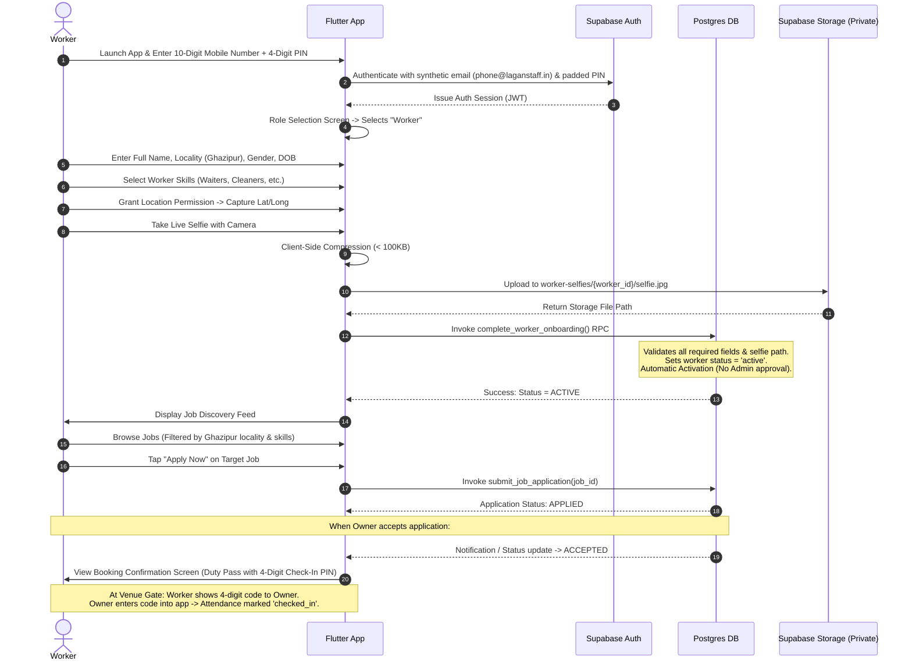
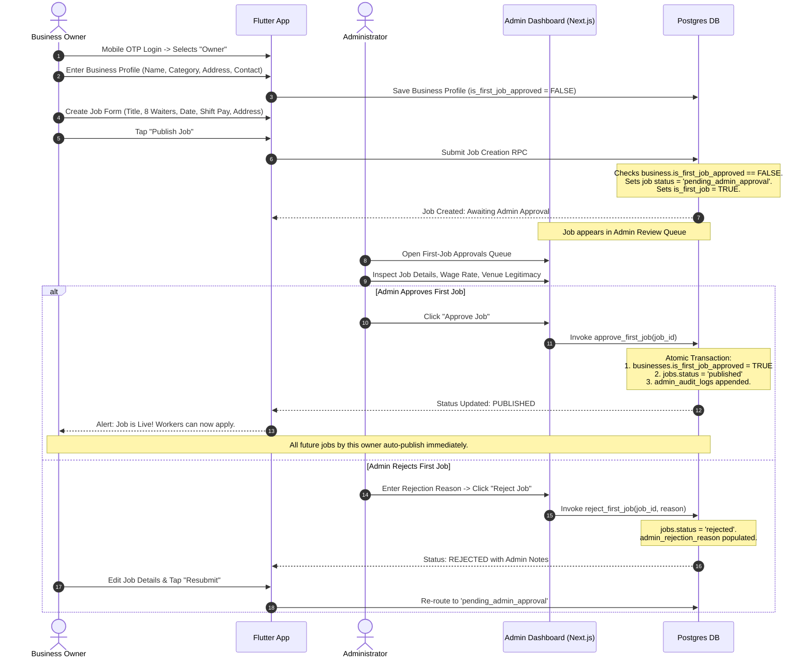
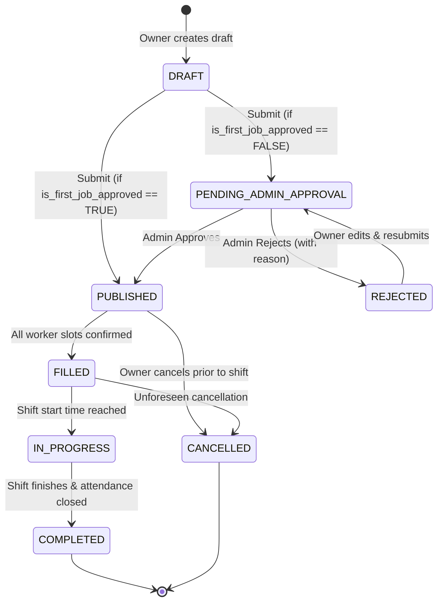
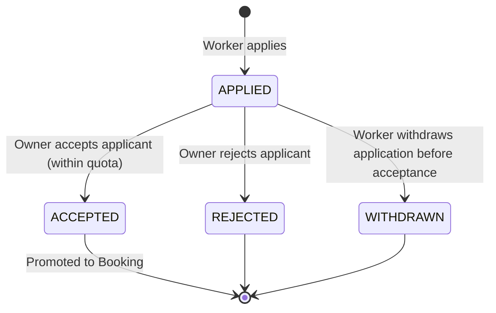
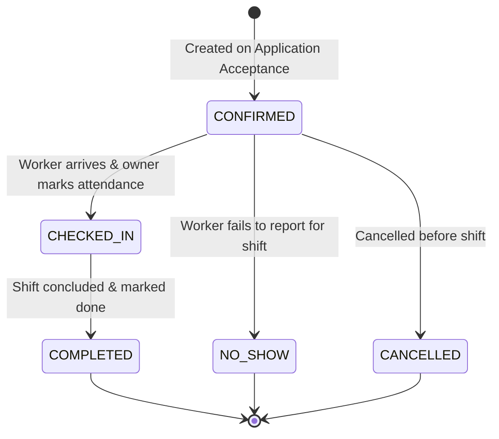

# LaganStaff — User Workflows & State Machine Architecture

**Document Version:** 1.0.0  
**Status:** Approved for Phase 0 Planning  
**Scope:** Complete User Journeys, State Machines, and Capacity Logic  

---

## 1. Worker Workflow Journey



---

## 2. Owner Workflow Journey & First-Job Moderation



---

## 3. Administrator Workflow

1. **Authentication:**
   - Admin accesses `admin.laganstaff.com`.
   - Authenticates using pre-provisioned credentials.
   - Zero public sign-up route exists; brute-force rate-limiting enforced on server.
2. **Operations Dashboard:**
   - Real-time KPI cards: Total Workers Registered, Total Verified Businesses, First-Jobs Pending Review, Active Shifts Today.
3. **First-Job Review Queue:**
   - Displays all jobs in `pending_admin_approval` status ordered by creation timestamp.
   - Inspects: Business category, location in Ghazipur, specified wage rate (flags sub-minimum rates), special conditions.
   - Action: **Approve** (commits business verification) or **Reject** (forces structured feedback).
4. **User & Business Governance:**
   - Search worker directory, inspect verification selfies, review dispute flags.
   - Action: Suspend fraudulent or non-reporting accounts (updates `status = 'suspended'`).
5. **Audit Ledger:**
   - Real-time, read-only feed of `admin_audit_logs` tracking every administrative mutation.

---

## 4. State Machines & Entity Lifecycles

### 4.1 Job Lifecycle State Machine



### 4.2 Application Lifecycle State Machine



### 4.3 Booking Lifecycle State Machine



---

## 5. Capacity Enforcement & Concurrency Architecture

### 5.1 The Race Condition Challenge
- **Scenario:** A marriage lawn owner in Ghazipur posts a job for **10 Waiters**.
- **Event:** A surge of **100 local workers** view the job simultaneously and tap "Apply".
- **Risk:** Without database-level controls, naive frontend checks or non-atomic queries can cause over-allocation (e.g., 14 workers accepted for 10 slots).

### 5.2 Transaction-Safe Resolution Architecture
Capacity enforcement is implemented at the database level inside a PostgreSQL stored procedure using **Row-Level Locking (`FOR UPDATE`)**:

```
Client Request (Accept Applicant)
               │
               ▼
   [BEGIN POSTGRES TRANSACTION]
               │
               ▼
   SELECT workers_needed, workers_confirmed 
   FROM jobs 
   WHERE id = target_job_id 
   FOR UPDATE;  <--- LOCKS JOB ROW EXCLUSIVELY
               │
      [workers_confirmed < workers_needed ?]
         ├── NO  ──> ROLLBACK TRANSACTION
         │           RAISE EXCEPTION "Job capacity is full."
         │
         └── YES ──> UPDATE jobs 
                     SET workers_confirmed = workers_confirmed + 1,
                         status = CASE WHEN (workers_confirmed + 1) = workers_needed 
                                       THEN 'filled'::job_status 
                                       ELSE status END
                     WHERE id = target_job_id;
                     
                     UPDATE job_applications 
                     SET status = 'accepted' 
                     WHERE id = target_application_id;
                     
                     INSERT INTO bookings (job_id, application_id, worker_profile_id, business_id, agreed_wage, status)
                     VALUES (...);
                     
                     [COMMIT TRANSACTION]  <--- LOCK RELEASED
```

This guarantees that even under extreme concurrency, exactly 10 bookings can be confirmed.
